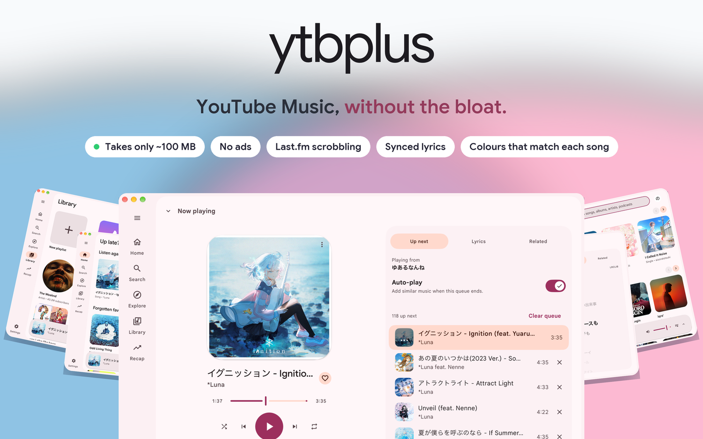
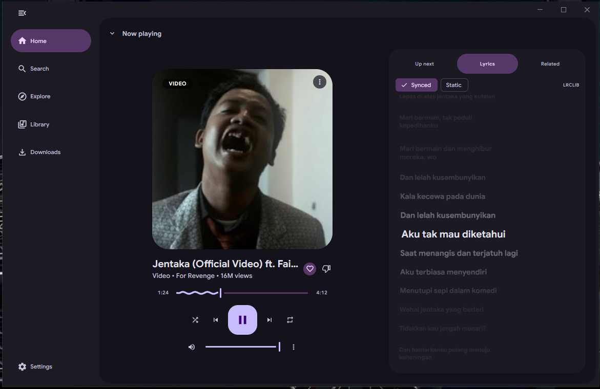

<p align="center">
  <picture>
    <source media="(prefers-color-scheme: dark)" srcset="docs/promo/hero-dark.png">
    
  </picture>
</p>

<h1 align="center">ytbplus</h1>

<p align="center">
  A native desktop player for YouTube Music. About 100 MB of memory, no ads,
  Last.fm scrobbling, synced lyrics, and colours that follow each song.
</p>

<p align="center">
  <a href="https://github.com/latiefahmad/ytbplus/releases/latest"></a>
  <a href="https://github.com/latiefahmad/ytbplus/releases"></a>
  <a href="LICENSE"></a>
  <a href="https://saweria.co/latiefahmad"></a>
</p>

<p align="center">
  <a href="#install"><b>Install</b></a> ·
  <a href="#features">Features</a> ·
  <a href="#signing-in">Signing in</a> ·
  <a href="#troubleshooting">Troubleshooting</a> ·
  <a href="#build-from-source">Build</a> ·
  <a href="CONTRIBUTING.md">Contribute</a> ·
  <a href="https://saweria.co/latiefahmad">☕ Support</a>
</p>

<p align="center">
  <a href="docs/screenshots/lyrics.png"></a><br>
  <sub>The full player: synced lyrics, the sung line lit in the middle.</sub>
</p>

> **Beta and unofficial.** ytbplus is an independent project. It is not made,
> endorsed or supported by YouTube or Google, and it uses YouTube's private web
> interfaces, which YouTube can change at any time. When that happens, parts of
> ytbplus may stop working until it is updated. See
> [Known issues](#known-issues) and [Troubleshooting](#troubleshooting).

## Why ytbplus

YouTube Music has no desktop app, and the web app takes 600–800 MB of RAM in a
browser tab. ytbplus is what I wanted instead: a native window that plays the
music without loading the web page, in about a tenth of the memory — and in
Material 3 Expressive, which the official app still isn't.

| | ytbplus | YouTube Music in a browser tab |
| --- | ---: | ---: |
| Memory | ~100 MB | 600–800 MB |
| Ads from the web page | none | shown |
| Synced lyrics | built in | limited |
| Colours from the album art | built in | — |
| Last.fm scrobbling | built in | needs an extension |

## Features

### Find your music

- **Home and Explore.** The same recommendations, new releases and charts you
  see on YouTube Music.
- **Search.** Songs, albums, artists and playlists, with filters. Recent
  searches are saved.
- **Podcasts.** Browse shows, read episode details, pick up where you left off.
- **Every page you expect.** Artist, album and playlist pages, plus song menus
  for play next, start a radio, and copy a link to share.

### Listen

- **No web-page ads.** ytbplus plays the music directly instead of loading the
  YouTube Music web page.
- **A full player.** Play, pause, skip, shuffle, repeat, volume, and a queue you
  can see and change. A small player follows you while you browse.
- **Lyrics that follow the song.** The sung line is highlighted, and word-synced
  lyrics light each word. ytbplus takes them from Better Lyrics, YouTube Music
  or LRCLIB, and you can switch to plain text.
- **Music that keeps going.** When your queue ends, ytbplus adds similar songs.
- **Pick up where you left off.** Your queue and song are waiting next time.

### Your account and library

- **Sign in with your Google account** for your personalized Home feed and
  Library. ytbplus never sees your password, and you can browse and play
  without signing in.
- **Manage your library.** Like songs, follow artists, save albums and
  playlists, and create or delete your own.
- **Organize playlists.** Sort by title, artist or length, or search inside one.

### Make it yours

- **Equaliser.** Bass, treble and everything between, with presets and volume
  levelling.
- **Colours and themes.** Light, dark, or follow your system. Pick a colour, or
  let the album art choose it — or take them from matugen to
  [match the rest of your desktop](#match-your-desktop-with-matugen).
- **Keyboard shortcuts**, and keys you can change.
- **Zoom** from 80% to 200%.
- **Last.fm scrobbling**, pausable any time, and **listening stats** kept on
  your computer and clearable whenever you like.

### Desktop niceties

- **Keeps playing when you close the window.** Use the mini player from the
  tray on macOS and Windows; the Linux tray offers **Open ytbplus** and **Quit**.
- **Works with your computer's controls.** Media keys, the macOS Now Playing
  widget, and Linux media controls.
- **Discord Rich Presence** for the track you're playing.
- **Caches recent songs**, and **updates itself** once a day if you leave that
  on.

## Install

<a href="https://github.com/latiefahmad/ytbplus/releases/latest"></a>

Pick one file from the [releases page](https://github.com/latiefahmad/ytbplus/releases).

**1. Find your system.**

| You have | Download the file that ends in |
| --- | --- |
| A Mac (any Mac) | `.dmg` |
| Windows | `-portable.zip`, or the `-setup.exe` installer |
| Ubuntu, Debian, Linux Mint, Pop!_OS | `.deb` |
| Fedora | `.rpm` |
| Any Linux with Flatpak (full build only) | `.flatpak` |
| Arch, Manjaro, or any other Linux | `.AppImage` |

The `.AppImage` needs no installer: make it executable, then open it.

**2. Choose the right processor (Linux only).** Run `uname -m`: `x86_64` means
take the file with `amd64` in its name, `aarch64` means `arm64`. Macs and
Windows need no choice — one `.dmg` covers Apple Silicon and Intel, and the
Windows builds are `amd64`.

**3. Take a full build unless you know you want minimal.** Files with
`-minimal` expect `ffmpeg`, `yt-dlp`, and Node.js or Bun already on your
`PATH`, and they break playback without them. If you use one, keep `yt-dlp`
current.

Skip files named `update-*.json`, files ending in `.delta`, and the Windows
update `.tar.gz`; ytbplus uses those to update itself.

### Install steps

- **macOS.** Open the disk image and drag ytbplus to Applications. It is not
  notarized yet, so the first time, right-click it and choose **Open**.
- **Windows.** Extract the `-portable.zip` and run `ytbplus.exe` from the
  extracted folder; it needs no installer or administrator rights. **Windows
  support is untested** — please report what you find.
- **Linux.** Install the `.deb` or `.rpm`, or run
  `flatpak install --user ytbplus-<version>-linux-amd64.flatpak`. All Linux
  builds need GTK 3 and WebKitGTK 4.1; the tray also needs the AppIndicator
  runtime, which the `.deb` and `.rpm` install for you
  (see [the Linux tray note](#the-linux-tray-is-missing-or-open-ytbplus-does-nothing)).

## Signing in

Signing in gives you your personalized Home feed and Library, but public
browsing and playback need no account at all.

**The quick way: import from the browser you already use.** Sign in at
[music.youtube.com](https://music.youtube.com) in Chrome, Edge, Brave, Firefox,
Safari or Helium, open ytbplus, choose **Sign in → Import from a browser**, and
pick that browser. No email or password is typed into ytbplus, which never sees
your password either way.

An imported session is a copy of one your browser keeps using, so YouTube can
replace its cookies and leave the copy dead — often within hours. If that
happens, import again.

**The durable way: the sign-in window.** Under **Other ways to sign in**,
**Sign in with a browser window** opens a separate window with a new, empty
profile. It is not your browser, so your bookmarks, extensions and saved
passwords are not there, but the session it produces is not shared with any
browser and keeps working longer.

- Google may refuse it with "This browser or app may not be secure". Its checks
  can change at any time.
- Close the window only after it finishes; a sign-in that takes more than five
  minutes stops by itself.
- The Flatpak cannot open that window until you let it start programs outside
  its sandbox:
  `flatpak override --user --talk-name=org.freedesktop.Flatpak com.latiefahmad.ytbplus`.

Anyone who has your session has your account, so treat it like a password.
[Privacy](#privacy) covers where ytbplus keeps it.

## Match your desktop with matugen

ytbplus can use the full set of colours matugen makes. Matugen writes them to
their own file, `colors.json`, so your settings are never touched.

1. Copy [`ytbplus-colors.json`](docs/matugen/ytbplus-colors.json) to
   `~/.config/matugen/templates/`.
2. Add it to `~/.config/matugen/config.toml`. The output goes in ytbplus's data
   folder, next to `settings.json` (`~/.config/ytbplus` on Linux,
   `~/Library/Application Support/ytbplus` on macOS, `%AppData%\ytbplus` on
   Windows):

   ```toml
   [templates.ytbplus]
   input_path = "~/.config/matugen/templates/ytbplus-colors.json"
   output_path = "~/.config/ytbplus/colors.json"
   ```

3. Run matugen as usual, for example `matugen image wallpaper.png`.
4. In Settings → Appearance, set **Colour source** to **Matugen**.

ytbplus recolours as soon as the file changes, and falls back to your seed if
you delete it. The file holds a light and a dark set, so Theme still chooses
between them. While the source is Matugen the colour and palette pickers are
hidden; **Fixed** and **Artwork** bring them back and ignore the file. A role
the file leaves out keeps the colour ytbplus makes from your seed.

## Troubleshooting

**Where are the logs?** Settings → **Open logs folder**. ytbplus writes
`ytbplus.log` there, rolling over to three older files, and the top of each
lists the versions of ytbplus, ffmpeg and yt-dlp in use. Passwords and cookies
are stripped before writing, but read a log before you post it.

<details>
<summary><b>Nothing plays, or a track fails</b></summary>

Check that you are online, then try another track: some are unavailable in your
region or need an account. ytbplus finds streams with yt-dlp, and YouTube
changes often, so an old yt-dlp stops working — install a newer release, or
update the `yt-dlp` on your `PATH` if you use a minimal build.

</details>

<details>
<summary><b>ffmpeg or yt-dlp problems</b></summary>

The full build bundles both. The minimal build needs `ffmpeg`, `yt-dlp`, and
Node.js or Bun on `PATH`. Run `ffmpeg -version` and `yt-dlp --version` to check
them; the log header shows which versions ytbplus found.

</details>

<details>
<summary><b>Sign-in problems</b></summary>

- If a browser import ended, sign in at [music.youtube.com](https://music.youtube.com)
  in that browser first, then import again. Use a profile that is signed in.
- Some browsers lock their cookie file while running. Close the browser, or try
  again after it has been open for a moment.
- On Linux the cookies are encrypted with the desktop keyring. If it is locked
  or missing, unlock it or try another browser.
- If YouTube signed you out in the browser, the saved session is dead: choose
  **Sign out**, then sign in again.

</details>

<details>
<summary id="the-linux-tray-is-missing-or-open-ytbplus-does-nothing"><b>Linux: the tray is missing, or Open ytbplus does nothing</b></summary>

The tray needs the AppIndicator runtime and a panel that supports
AppIndicator or StatusNotifier icons; GNOME may need an extension enabled. The
`.deb` and `.rpm` install the runtime — for an AppImage or `.tar.gz`, install
`libayatana-appindicator3-1` on Debian/Ubuntu or `libayatana-appindicator-gtk3`
on Fedora.

Linux tray protocols report neither icon clicks nor icon position, so a
mini-player flyout would open in the centre of the display rather than beside
the icon. ytbplus skips it; its Linux tray menu only offers **Open ytbplus** and
**Quit**. Without a tray the player still works, but **Close to tray** does
not. Media controls use MPRIS and never depend on the tray.

</details>

<details>
<summary><b>Linux does not start</b></summary>

ytbplus needs GTK 3 and WebKitGTK 4.1. Install them with your package manager.

</details>

<details>
<summary><b>macOS says the app can't be opened</b></summary>

ytbplus is not notarized yet. Right-click it and choose **Open**, or allow it in
System Settings > Privacy & Security.

</details>

<details>
<summary><b>Still stuck</b></summary>

Settings has a report button that opens a GitHub issue prefilled with your
versions. Otherwise [open an issue](https://github.com/latiefahmad/ytbplus/issues)
and attach the relevant part of the log.

</details>

## Known issues

- ytbplus depends on YouTube's private interfaces and on yt-dlp, so a change on
  YouTube's side can break browsing, playback or sign-in until a fix ships.
- The Windows build is untested, and the macOS app is not notarized.
- Sign-in needs a browser session, because YouTube Music offers no sign-in for
  other apps. Google may refuse the sign-in window, and an imported session can
  stop working within hours.
- Tracks that YouTube restricts for your region or account may not play.

See the [open issues](https://github.com/latiefahmad/ytbplus/issues) for the rest.

## Privacy

ytbplus runs no account service, analytics, telemetry or servers of its own. It
talks to YouTube and Google for YouTube Music, streams and artwork, and uses
yt-dlp to find streams. If you connect Last.fm it also sends your listening
there, and when automatic updates are on it checks its update server. Both can
be turned off in Settings.

What stays on your device:

- **Settings, listening history and playback state** in the app's user data
  folder. Settings has a button to clear the history.
- **Your session**, and **your Last.fm session**, each in a file only your user
  can read and encrypted with a key in the system credential store — the
  Keychain on macOS, the Secret Service on Linux, the Credential Manager on
  Windows. On macOS the first launch after an update asks once to use the key:
  choose **Always Allow**. Without a credential store the file is not
  encrypted. **Sign out** and **Disconnect** delete them.
- **Cached audio and artwork** in the folder you chose; set the audio limit to
  `0` to turn caching off.
- **Logs**, with secrets removed.

ytbplus reads cookies only when you ask it to sign in, and only to take the
YouTube Music session — from the window it opened, or from the browser you
picked.

## Non-goals

ytbplus stays small on purpose. These will not be implemented, and a pull
request that adds one will not be accepted. Fork away if you want them:
[GroophyLifefor/ytbplus](https://github.com/GroophyLifefor/ytbplus) added
SoundCloud, a sync server, MusicBrainz linking and more on top of ytbplus, and
is a good place to see how.

- **Video.** Music videos play as audio, with a badge on the artwork.
- **Local files.** ytbplus plays what YouTube Music has.
- **Uploads.** No uploading or managing an upload library.
- **Casting.** It plays on the computer it runs on.
- **Other services.** YouTube Music only — no Spotify or Apple Music.
- **Social features.** It changes only your own library.

## Build from source

You need [Bazel](https://bazel.build/), installed through
[bazelisk](https://github.com/bazelbuild/bazelisk) so it reads the pinned
version from `.bazelversion`.

```sh
bazel run //:dev                                    # live reload; ffmpeg and yt-dlp on PATH
bazel run //:dist -- --run linux-amd64              # production build with bundled tools, then open it
bazel run //:dist -- --run --minimal linux-amd64    # build against system ffmpeg, yt-dlp, and Node.js/Bun
```

`bazel run //:dist -- <platform>` builds into `build/<platform>/`. The
platforms are `darwin-universal`, `darwin-arm64`, `darwin-amd64`, `linux-amd64`
and `linux-arm64`. Releases ship full and minimal builds of each; see
[Install](#install) for the files.

## Contributing

Bug reports, fixes and docs are welcome. Read
[CONTRIBUTING.md](CONTRIBUTING.md) first, and check the
[non-goals](#non-goals) before you propose a feature.

## Support

<p align="center">
  <a href="https://saweria.co/latiefahmad"></a>
</p>

ytbplus is free, with no ads, no tracking and no paid tier. If it earns a place
in your day, you can support it at
**[saweria.co/latiefahmad](https://saweria.co/latiefahmad)**. It is a
thank-you, not a subscription: nothing is locked behind it, and it buys no say
in the [non-goals](#non-goals).

## Credits

- [MyGo](https://mygo.egoist.dev/) by [EGOIST](https://github.com/egoist), the
  framework that draws ytbplus's native window and interface.
- [ffmpeg](https://ffmpeg.org) decodes the audio,
  [yt-dlp](https://github.com/yt-dlp/yt-dlp) finds the streams, and
  [QuickJS](https://github.com/quickjs-ng/quickjs) runs the JavaScript yt-dlp
  needs to solve YouTube's challenges when Node or Bun is not installed. The
  full build ships all three; the minimal build leaves them to the system. See
  [`resources/THIRD-PARTY-NOTICES.md`](resources/THIRD-PARTY-NOTICES.md).
- [Google Sans](https://github.com/googlefonts/googlesans) sets the text, under
  the SIL Open Font License (`fonts/OFL.txt`).

## License

ytbplus is free software under the [GNU General Public License v3.0](LICENSE).

ytbplus is an independent project and is not affiliated with or endorsed by
YouTube or Google.
